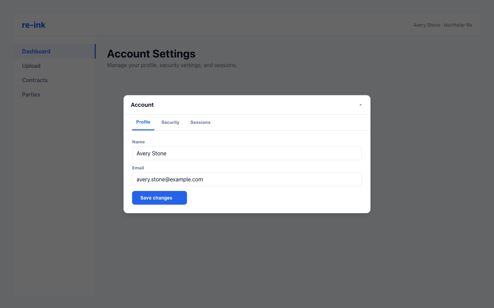

# Account Settings

The account panel gives signed-in users access to self-service WorkOS account tools.

The account panel centralizes profile, security, and session management for signed-in users.

## Open account settings

1. Open the account menu from the app sidebar.
2. Choose the account or profile option.
3. Use the available tabs to manage your profile, security, or active sessions.

## Available settings

Depending on your configuration, the account panel may include:

- Profile information.
- Security settings.
- Active sessions.

## If account settings fail to load

Contact your administrator. Account widgets require the backend to be configured for WorkOS server-side widget tokens.
