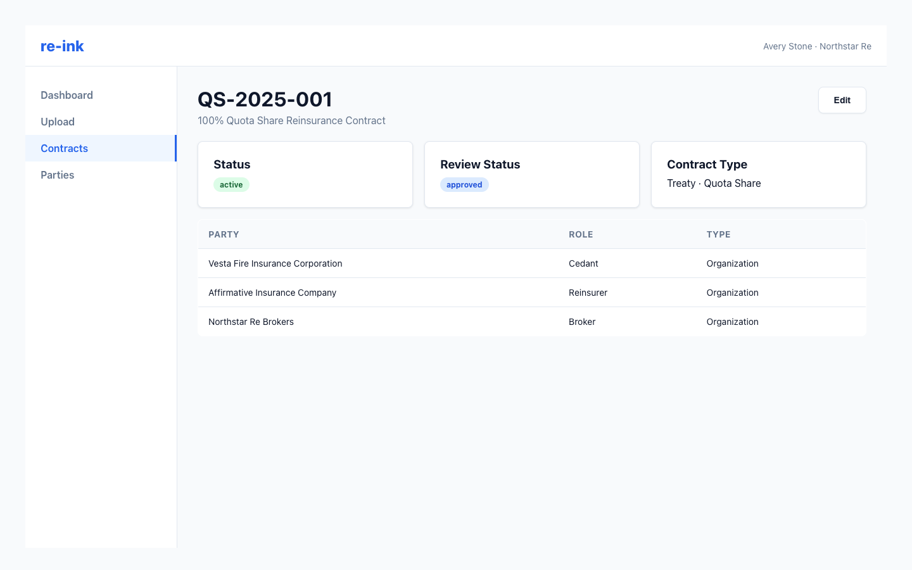

# Managing Contract Parties

Contract parties are organizations connected to a specific contract with a role.

The party table shows which organizations are linked to the contract and what role each one plays.

## Add a party to a contract

1. Open the contract detail page.
2. Add or link the party.
3. Choose the party's role on the contract.
4. Save the association.

## Update a party role

If the party is correct but the role is wrong, update the role on the contract. Do not create a duplicate party just to change the role.

## Remove a party

Remove a party association when the party should not be linked to that contract. This does not delete the party record itself.

## Role examples

- **Cedant**: The insurer transferring risk.
- **Reinsurer**: The organization assuming risk.
- **Broker**: The intermediary arranging the contract.
- **Other**: Any other relevant contract participant.
