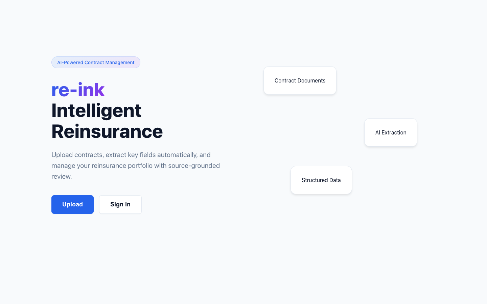

# Signing In

re-ink uses WorkOS AuthKit for sign-in. Your account is tied to an organization so contract and party data stays scoped to your company or team.

The landing page gives users a direct sign-in path before they enter protected contract workflows.

## Sign in

1. Open re-ink in your browser.
2. Select the sign-in action on the home page.
3. Complete the WorkOS sign-in flow.
4. After sign-in, confirm you land in the main app navigation.

## First-time access

If your account is not yet connected to an organization, re-ink provisions one automatically and switches your session into that organization. This may take a moment after your first sign-in.

## If sign-in fails

- Confirm you are using the email address expected by your organization.
- Refresh the page and try again if the authentication service is temporarily unavailable.
- Contact your administrator if you can sign in but cannot access contracts, parties, or uploads.
