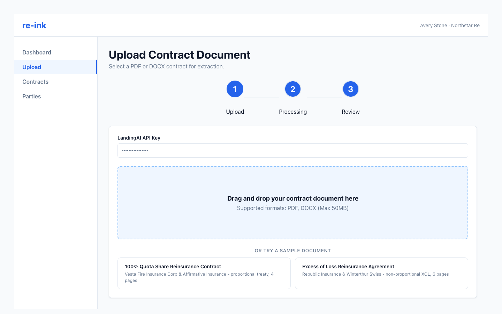

# Uploading a Contract

Use the Upload page to submit a reinsurance contract for AI extraction. re-ink supports PDF and DOCX documents.

The Upload page accepts your contract document and also provides sample documents for training or demos.

## Upload a document

1. Go to **Upload**.
2. Drag a contract file into the upload area, or select a file from your computer.
3. If your administrator has not configured a shared LandingAI key, enter your own LandingAI API key when prompted.
4. Start the upload.
5. Wait for the extraction status to show completion.

## What happens after upload

re-ink stores the original document, sends it for extraction, and creates an extraction job. When extraction is complete, the review form opens with contract fields, parties, and source evidence when available.

## Before continuing

Check that:

- The uploaded file is the intended contract.
- The extraction completed successfully.
- The review form shows the expected contract and party sections.
