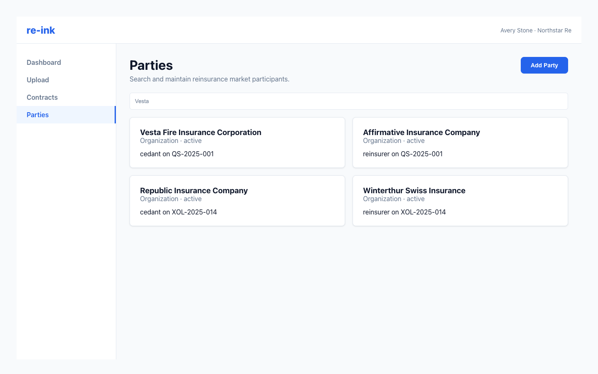

# Searching Parties

Use the Parties page to find organizations involved in contracts.

Use the Parties page to search for existing organizations before creating new party records.

## Search by name

Enter part of the legal name or common name in the search field. Review the results for spelling, abbreviations, and related entities.

## Open party details

Select a party to view its details and related information.

## Search during review

The review workflow also includes party search so you can link extracted parties to existing records before approval.

## Avoid duplicates

Before creating a new party, search for common variations of the name. For example, compare abbreviations, punctuation, and legal suffixes.
