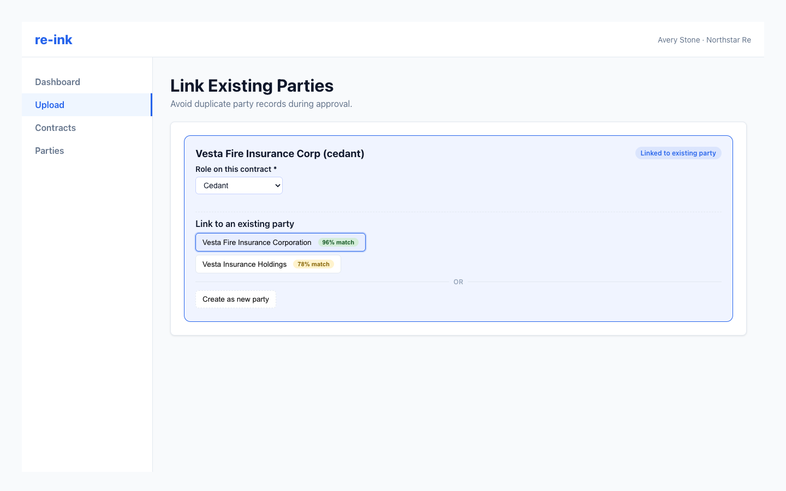

# Linking Existing Parties

During review, re-ink checks extracted party names against existing party records to reduce duplicates.

Party matching helps reviewers reuse existing party records instead of creating duplicates.

## Choose a party action

For each extracted party, decide whether to:

- Link to an existing party.
- Create a new party.

If re-ink suggests a strong match, compare the names and details before selecting it.

## Search manually

If the suggested matches are not right, use party search to look for an existing organization by name.

## Keep roles accurate

Linking to an existing party does not replace the role on the contract. Confirm the role separately for each contract party link.

## When to create a new party

Create a new party when no existing party record represents the same legal entity. Avoid creating a new party for spelling, punctuation, or abbreviation differences if the entity already exists.
