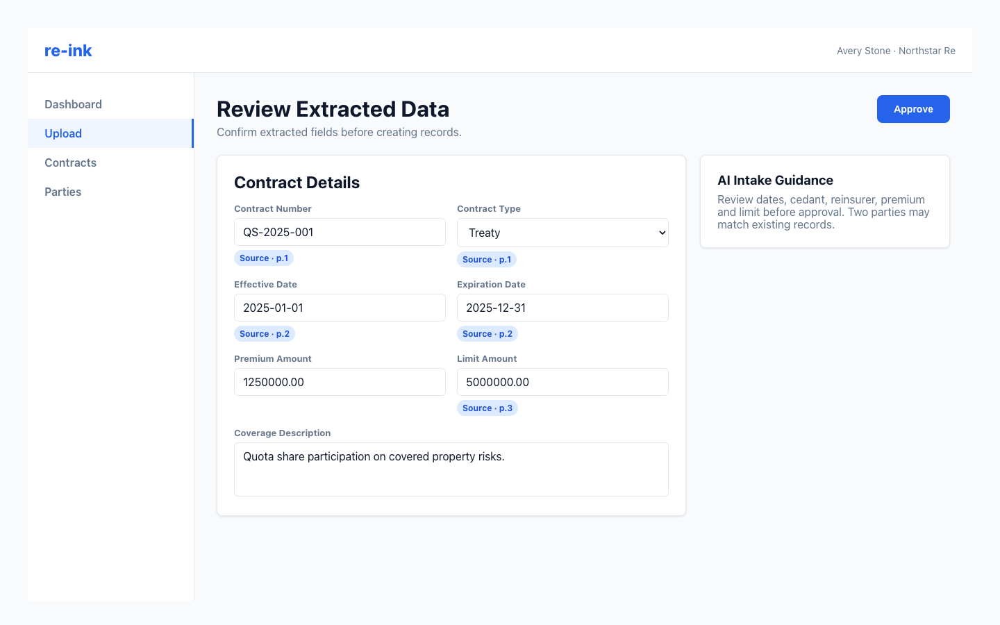

# Reviewing Extracted Fields

The review form is where you confirm AI-extracted contract and party information before records are created.

The review form groups extracted contract fields, party data, source indicators, and AI guidance into one approval workspace.

## Review contract fields

Check the main contract section first:

- Contract name and number.
- Contract type, subtype, and nature.
- Effective and expiration dates.
- Premium, retention, limit, and currency fields.
- Coverage details and source document name.

Edit any field that is incomplete, incorrectly formatted, or inconsistent with the source document.

## Review party fields

For each extracted party, confirm:

- Legal name.
- Party type.
- Contact details, if present.
- Role on this contract, such as cedant, reinsurer, broker, or other.

Party role is specific to the contract. The same organization can be a cedant on one contract and a reinsurer on another.

## Required checks

Before approval, make sure required fields are present and that edited values match the contract document.
