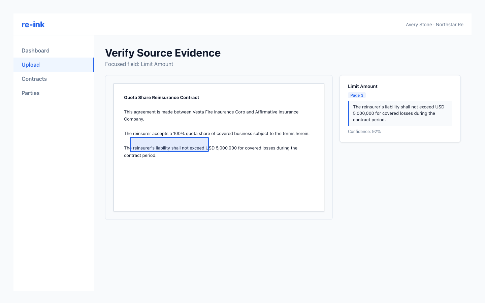

# Verifying Source Evidence

Source evidence helps you confirm where an extracted value came from in the original document.

Source evidence pairs the extracted field with the supporting page and passage from the source document.

## How source evidence appears

Fields may show a source indicator with a page number. When you focus a field, the source panel shows the related passage and document preview when available.

## Verify a field

1. Select or focus the field you want to verify.
2. Review the source passage in the side panel.
3. Compare the extracted value with the highlighted area or page reference.
4. Correct the field if the source does not support the extracted value.

## If no source is found

A field may have no source evidence. This does not always mean the value is wrong, but it does mean the field needs manual verification against the document.

## Reviewer standard

Use source evidence as support, not as a substitute for review judgment. Confirm high-impact fields such as dates, limits, retention, premium, cedant, and reinsurer before approval.
